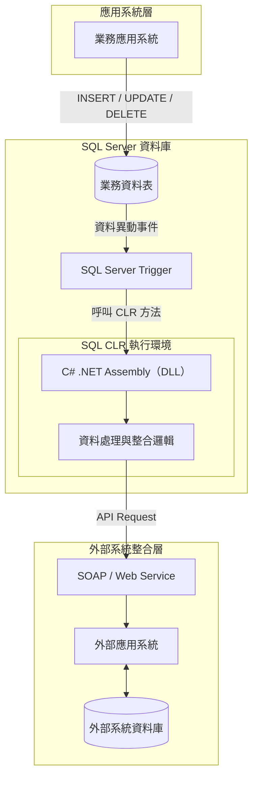
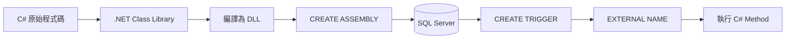
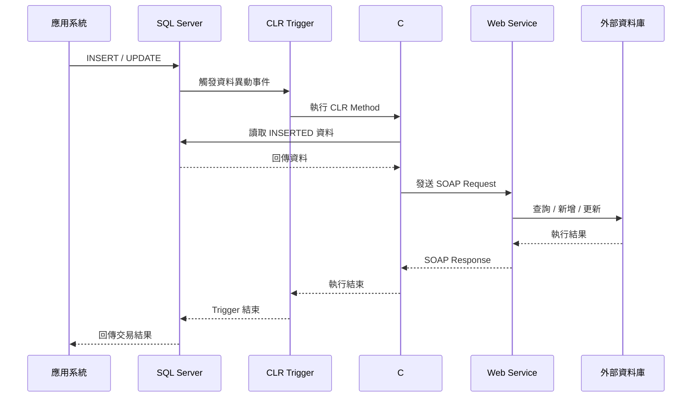
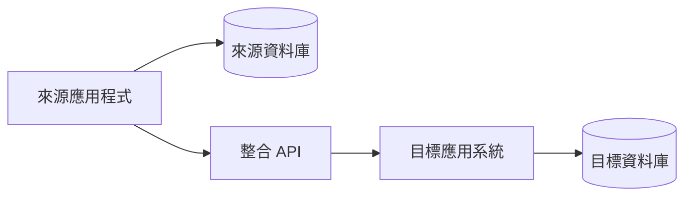
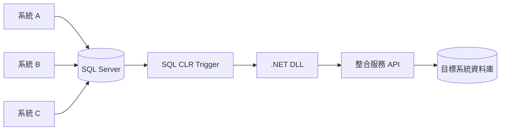

# SQL Server CLR Trigger — 資料庫與外部系統整合架構

## 1. 架構概述

**SQL Server CLR Trigger** 是結合 Microsoft SQL Server 與 .NET Common Language Runtime（CLR）的資料庫擴充技術。

一般 SQL Server Trigger 使用 T-SQL 撰寫，主要處理資料庫內部的資料邏輯。

透過 SQL CLR 技術，可以將 C# 程式編譯成 .NET DLL，註冊至 SQL Server，讓 SQL Server 在特定資料異動事件發生時，直接執行 C# 方法。

此架構使資料庫不再只是儲存與查詢資料，也能作為不同資訊系統之間的事件觸發與整合節點。

### 核心技術

| 技術 | 說明 |
|---|---|
| SQL Server | 資料儲存及事件觸發 |
| SQL Server Trigger | 偵測 INSERT、UPDATE、DELETE |
| SQL CLR | 在 SQL Server 中執行 .NET 程式 |
| C# Class Library | 封裝資料處理與系統整合邏輯 |
| ADO.NET | 存取 SQL Server 資料 |
| SOAP Web Service | 與外部應用系統交換資料 |
| 外部資料庫 | 接收、儲存或提供整合資料 |

---

## 2. SQL Server CLR Trigger 整體系統架構



### 架構說明

1. 應用系統對 SQL Server 資料表進行新增、修改或刪除。
2. SQL Server 偵測符合條件的資料異動，觸發對應 Trigger。
3. Trigger 呼叫已註冊的 C# CLR Assembly。
4. C# 程式可在 SQL Server CLR 環境中執行資料驗證、轉換及其他整合邏輯。
5. CLR 程式透過 Web Service 與外部系統交換資料。
6. 外部系統根據業務需求操作自己的資料庫。

**核心特色：** 系統整合邏輯直接部署於 SQL Server 執行環境，不需要由來源應用程式額外呼叫同步 API。

---

## 3. SQL Server 與 .NET DLL 整合架構

SQL Server CLR 的主要特色是允許資料庫執行由 .NET 語言編譯的程式組件。



### 部署流程

**Step 1：使用 C# 開發 CLR 程式**

```csharp
using System;
using Microsoft.SqlServer.Server;

public partial class Triggers
{
    [SqlTrigger(
        Name = "MyClrTrigger",
        Target = "dbo.MyTable",
        Event = "FOR INSERT, UPDATE"
    )]
    public static void ExecuteTrigger()
    {
        SqlTriggerContext context =
            SqlContext.TriggerContext;

        // 資料處理與外部系統整合
    }
}
```

**Step 2：編譯 C# DLL**

將 C# Class Library 編譯成符合目標 SQL Server CLR 執行環境的 DLL。

**Step 3：註冊 CLR Assembly**

以下為示意 SQL，實際部署需先完成 CLR 安全性與信任設定。

```sql
EXEC sp_configure 'clr enabled', 1;
RECONFIGURE;

CREATE ASSEMBLY MyClrAssembly
FROM 'C:\CLR\MyClrAssembly.dll'
WITH PERMISSION_SET = UNSAFE;
```

**Step 4：建立 SQL CLR Trigger**

```sql
CREATE TRIGGER dbo.trg_MyClrTrigger
ON dbo.MyTable
AFTER INSERT, UPDATE
AS EXTERNAL NAME
    MyClrAssembly.[Triggers].ExecuteTrigger;
```

完成後，當 `dbo.MyTable` 執行符合條件的 DML 操作時，SQL Server 就會自動呼叫 DLL 中的 C# 方法。

> 注意：上述 `UNSAFE` 僅用於示範涉及外部資源的部署形式，並非所有 CLR Trigger 都需要此權限。正式環境應評估最低必要權限、Assembly 簽章及 `clr strict security` 設定，不應為方便部署而停用安全保護。

---

## 4. 資料庫直接觸發外部系統的執行流程



### 執行特性

- **事件驅動**：資料表異動時自動執行，不需要另外排程。
- **資料庫層整合**：不需修改每個來源應用程式即可共用觸發機制。
- **支援 C#**：可使用 .NET 程式語言實作較複雜的整合邏輯。
- **可連接外部系統**：透過 HTTP、SOAP 或其他受支援的介面進行整合。
- **同步執行**：AFTER CLR Trigger 通常在原始 DML 交易中執行，Trigger 尚未完成前，原始操作也不會正常完成。

外部 Web Service 的資料寫入不會自動加入 SQL Server 的本地交易，因此來源資料庫與目標資料庫之間，仍須另外設計交易一致性機制。

---

## 5. SQL CLR 如何讀取資料庫事件資料

SQL CLR Trigger 可以透過 `SqlContext.TriggerContext` 取得目前 Trigger 的上下文。

並透過 Context Connection 存取同一個 SQL Server 執行環境。

```csharp
SqlTriggerContext triggerContext =
    SqlContext.TriggerContext;

using (SqlConnection conn =
    new SqlConnection("context connection=true"))
{
    conn.Open();

    using (SqlCommand cmd = new SqlCommand(
        "SELECT * FROM INSERTED", conn))
    using (SqlDataReader reader = cmd.ExecuteReader())
    {
        while (reader.Read())
        {
            // 讀取異動後的資料
        }
    }
}
```

### INSERTED 與 DELETED

| 操作 | INSERTED | DELETED |
|---|---|---|
| INSERT | 新增後的資料 | 無 |
| UPDATE | 修改後的資料 | 修改前的資料 |
| DELETE | 無 | 刪除前的資料 |

`INSERTED` 與 `DELETED` 是 SQL Server Trigger 的邏輯資料表，可包含一次 DML 操作影響的多筆資料。

---

## 6. 傳統系統整合與 SQL CLR Trigger 比較

### 傳統應用程式整合



傳統方式通常由來源程式負責呼叫 API，因此不同應用程式可能需要分別實作同步功能。

### SQL CLR Trigger 整合



整合邏輯集中在資料庫事件層，即使有多個不同來源程式，只要資料異動符合 Trigger 條件，就會執行相同的處理程序。

### 架構比較

| 比較項目 | 傳統應用程式整合 | SQL CLR Trigger |
|---|---|---|
| 觸發位置 | 應用程式 | SQL Server |
| 執行時機 | 程式主動呼叫 | 資料異動事件 |
| 整合程式語言 | C#、Java 等 | SQL Server 支援的 .NET CLR 語言 |
| 資料庫內部事件存取 | 需額外查詢 | 可直接存取 INSERTED / DELETED |
| 多系統共用 | 需各系統配合 | 可集中於資料庫 |
| 外部服務整合 | 應用程式直接呼叫 | CLR DLL 呼叫 |
| 效能與交易影響 | 依架構設計 | 可能延長來源資料庫交易時間 |
| 部署維護 | 應用程式端 | SQL Server Assembly / Trigger |

---

## 7. 架構優點與設計限制

### 優點

- 能直接以 SQL Server 資料異動作為整合事件。
- 可以使用 C# 與 .NET 類別庫處理資料。
- 不必讓每個來源系統各自實作相同的同步流程。
- 能沿用既有 SOAP Web Service 服務。
- 適合需要在資料寫入後立即觸發特定處理程序的系統。

### 注意事項

1. **交易執行時間**：CLR Trigger 執行期間可能延長來源 SQL Server 交易，外部 API 若回應緩慢，也可能造成交易等待。
2. **資料庫負載**：Trigger 的額外運算會消耗 SQL Server 資源。
3. **外部服務可靠性**：Web Service 連線失敗或逾時時，必須明確設計失敗處理方式。
4. **部署安全性**：涉及外部網路存取的 CLR Assembly 應使用符合 SQL Server 版本的安全性設定。
5. **資料一致性**：SQL Server 與外部資料庫並不會因 SOAP 呼叫而自動形成單一交易。
6. **多筆資料處理**：一次 UPDATE 或 INSERT 可能影響多筆資料，CLR Trigger 必須正確處理多筆事件資料。

對於高頻率、大量資料同步或要求可靠重試的情境，可考慮採用 **SQL Server Outbox + Queue + Background Worker** 架構，將外部服務呼叫移出資料庫交易。

---

## 8. 總結

SQL Server CLR Trigger 是一種將 **資料庫事件、C# .NET 執行環境與外部資訊系統** 結合的整合架構。

透過在 SQL Server 註冊 .NET Assembly，資料庫可以在 INSERT、UPDATE、DELETE 等事件發生時，直接呼叫 C# 方法執行整合工作。

此技術特別適合既有系統無法輕易修改應用程式，卻需要根據資料庫異動觸發外部系統處理的情境。

其核心架構為：

**Application → SQL Server → CLR Trigger → C# DLL → Web Service → External System / Database**

這種方式能讓 SQL Server 同時承擔資料儲存與事件觸發的角色，但仍應依據交易一致性、安全性與效能需求，評估是否適合將外部整合邏輯直接放在資料庫執行環境。
